# Результати тестування системи (Лабораторна робота 10)

У рамках тестування проведено комплексну перевірку всіх компонентів системи:
1. **MVC веб-панелі адміністратора**: авторизація, збереження сесійного кукі `jwt_token`, доступ до операцій CRUD.
2. **REST API**: захист ендпоінтів атрибутом `[Authorize]`, видача JWT-токенів при успішному вході, перевірка хешів паролів за стандартом BCrypt.
3. **Дій користувача (Actions)**: отримання каталогу паркомісць, оформлення нового бронювання, блокування повторного бронювання зайнятого місця, скасування власного бронювання та звільнення місця.
4. **Бази даних SQLite**: застосування міграцій EF Core (`InitialCreate` та `UpdateSeedDataAndIndexes`), перевірка цілісності зв'язків (Foreign Keys).
5. **Клієнтського додатку .NET MAUI**: робота з REST API через `HttpClient`, локальне збереження JWT токена в `Preferences`, відображення статусів місць та виконання операцій бронювання/скасування.

---

## Зведена таблиця результатів тестування

| № | Тестовий сценарій | Метод / Маршрут | Очікуваний результат | Фактичний результат | Статус |
|---|---|---|---|---|:---:|
| 1 | Вхід адміністратора через веб-форму | `POST /auth/login` | Отримання захищеного кукі `jwt_token` | Кукі `jwt_token` успішно встановлено в сесії | **PASS** |
| 2 | Спроба доступу до API без авторизації | `GET /api/items` | Повернення статус-коду `401 Unauthorized` | Отримано код 401, доступ заблоковано | **PASS** |
| 3 | API аутентифікація працівника парковки | `POST /api/auth/login` | Статус `200 OK`, JSON із токеном та роллю `User` | Отримано валідний JWT токен для Sasha Yaschenko | **PASS** |
| 4 | Спроба входу з невірним паролем | `POST /api/auth/login` | Статус `401 Unauthorized`, перевірка BCrypt | Отримано 401, невірний пароль відхилено | **PASS** |
| 5 | Отримання списку місць через API | `GET /api/items` | Статус `200 OK`, масив паркувальних місць | Отримано повний список із 10 паркомісць | **PASS** |
| 6 | Створення бронювання вільного місця | `POST /api/actions` | Статус `201 Created`, зміна статусу на `Occupied` | Створено активне бронювання, місце зайняте | **PASS** |
| 7 | Спроба забронювати вже зайняте місце | `POST /api/actions` | Статус `400 Bad Request` | Отримано 400 Bad Request ("Це місце вже зайняте") | **PASS** |
| 8 | Скасування бронювання та звільнення місця | `DELETE /api/actions/{id}` | Статус `200 OK`, зміна статусу на `Free` | Бронювання скасовано, місце успішно звільнено | **PASS** |
| 9 | Перевірка цілісності зв'язків БД | `PRAGMA foreign_key_check` | 0 помилок зв'язку між таблицями | 0 помилок цілісності зовнішніх ключів | **PASS** |

---

## Порядок проведення тестування

1. **Серверна частина:**
   * Створити файл конфігурації у папці `Server/ServerApp`:
     ```powershell
     copy appsettings.example.json appsettings.json
     ```
   * Застосувати міграції EF Core для створення бази даних:
     ```powershell
     dotnet ef database update
     ```
   * Запустити сервер у **Visual Studio** (або через термінал: `dotnet run --project Server/ServerApp/ServerApp.csproj`).

2. **Тестування REST API:**
   * Через інтерактивний **Swagger UI**: перейти за адресою `http://localhost:5088/swagger` для перевірки ендпоінтів, помилки `401 Unauthorized` без токена та успішної видачі JWT (`200 OK`).
   * Через **Postman**: імпортувати готову колекцію [`Docs/ParkingManagement.postman_collection.json`](ParkingManagement.postman_collection.json), яка містить усі готові запити з автовстановленням токена.

3. **Веб-панель адміністратора:**
   * Відкрити `http://localhost:5088/auth/login` та увійти під обліковими даними адміністратора (`admin@parking.com` / `AdminPassword123!`) для перевірки CRUD операцій.

4. **Клієнтський застосунок .NET MAUI:**
   * Відкрити `Client/ClientApp/ClientApp.sln` у **Visual Studio**.
   * Запустити клієнт у середовищі Windows (**Windows Machine**). Застосунок використовує єдину платформонезалежну кодову базу MVVM (`CommunityToolkit.Mvvm`), тому бізнес-логіка, збереження сесії в `Preferences` та взаємодія через `HttpClient` ідентичні на Windows та мобільних платформах.

---

## Скріншоти тестування компонентів системи

### 1. Веб-панель адміністратора (MVC CRUD & Dashboard)

#### Головна панель керування (Dashboard)
Відображає загальну статистику системи (кількість вільних і зайнятих паркомісць, зареєстрованих працівників та активних бронювань) і швидкі посилання.
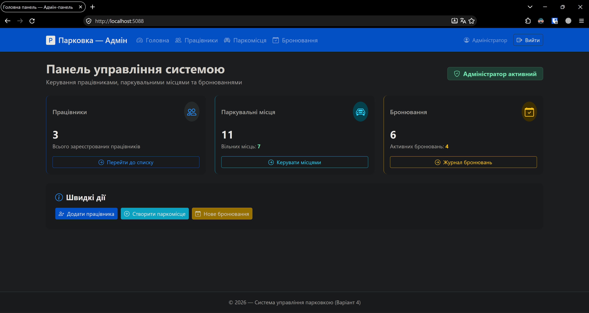

#### Журнал паркувальних місць (Items CRUD)
Таблиця паркувальних місць з реальними полями моделі: номер місця (`Number`), статус (`Status` — Вільне / Зайняте) та закріплений працівник (`Attendant`).
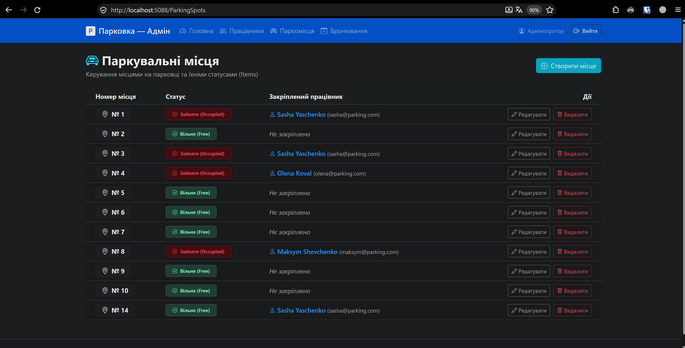

#### Список чергових та працівників парковки (Users CRUD)
Управління обліковими записами працівників парковки (поля: `ID`, ім'я `Name`, `Email`, збережений хеш пароля `PasswordHash`).
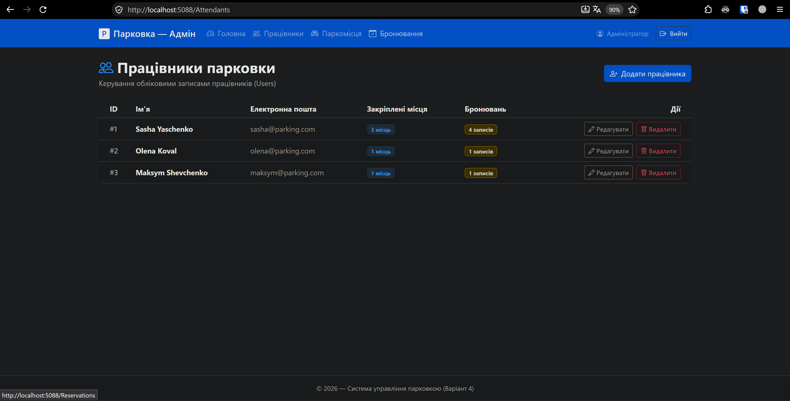

#### Журнал бронювань (Actions CRUD)
Таблиця записів бронювань (поля: `ID`, працівник `Attendant`, номер паркомісця `Spot`, дата бронювання `ReservationDate`, статус `Status`).
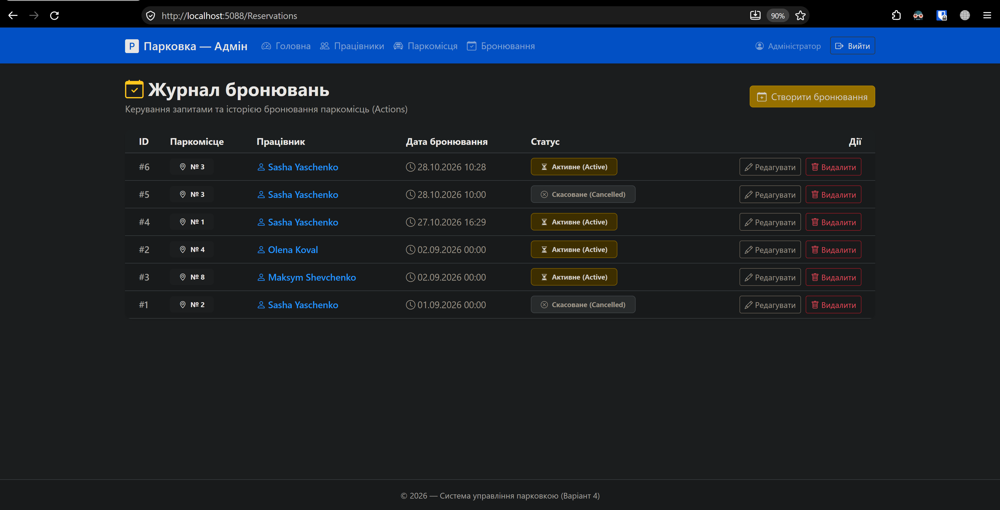

---

### 2. Форми додавання нових сутностей (Create Views)

#### Створення нового працівника (Add User)
Форма реєстрації нового працівника із введенням імені, email та пароля.
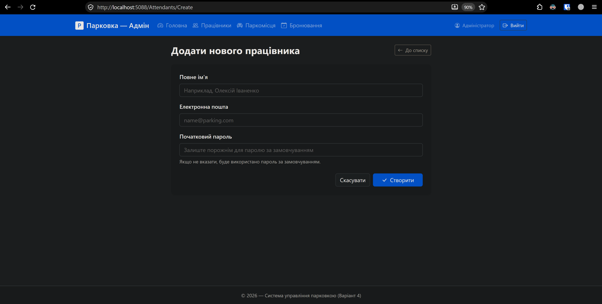

#### Створення нового паркомісця (Add Item)
Форма додавання паркомісця із зазначенням номера та початкового статусу.
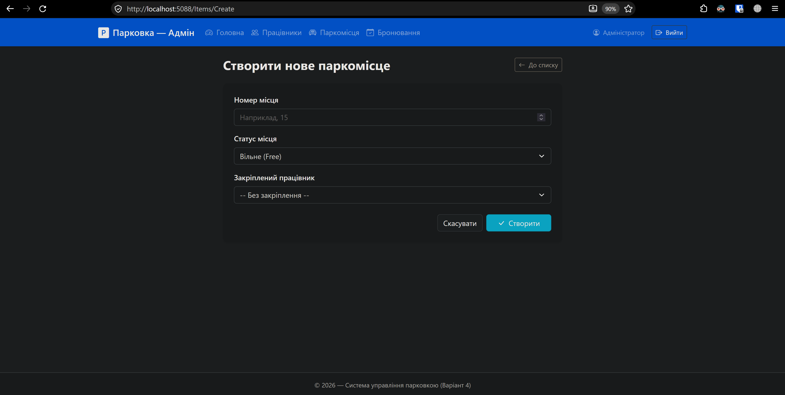

#### Створення нового бронювання (Add Action)
Форма оформлення запису бронювання адміністратором із вибором працівника та вільного паркомісця.
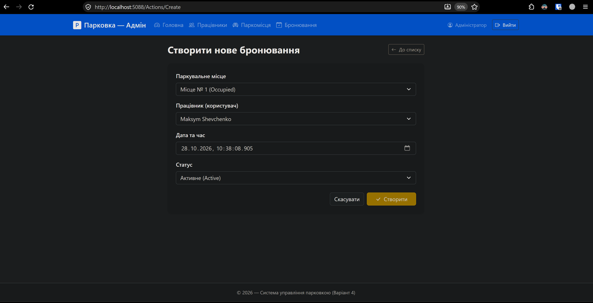

---

### 3. Форми редагування існуючих записів (Edit Views)

#### Редагування даних працівника (Edit User)
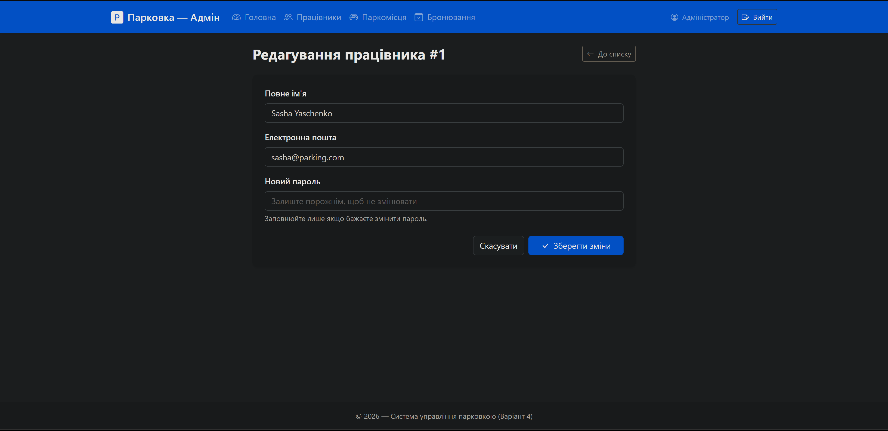

#### Редагування параметрів паркомісця (Edit Item)
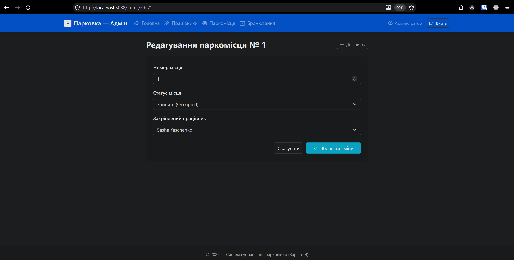

#### Редагування запису бронювання (Edit Action)
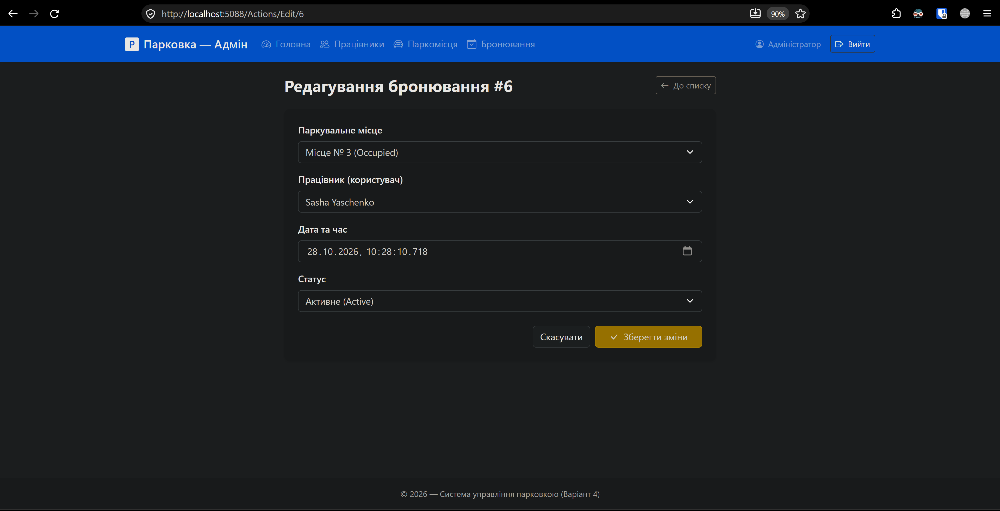

---

### 4. Тестування безпеки REST API (Swagger UI / Postman)

#### Перевірка захисту API (401 Unauthorized)
Запит до закритого ендпоінту `GET /api/items` без надання Bearer JWT токена успішно блокується сервером зі статус-кодом `401 Unauthorized` та заголовком `WWW-Authenticate: Bearer`.
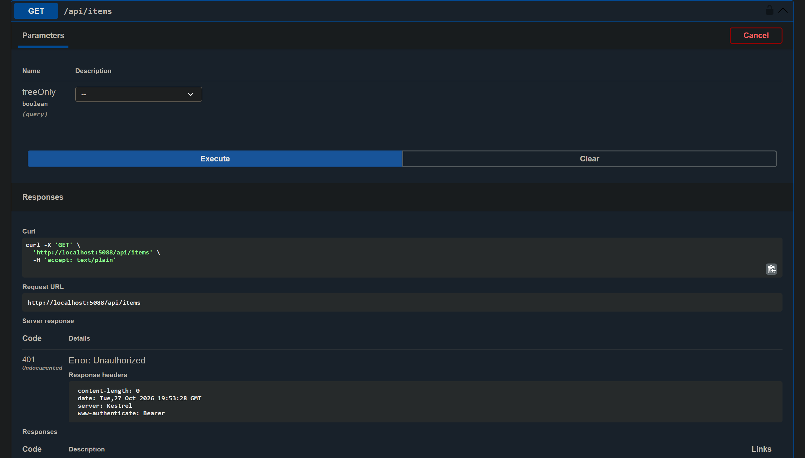

#### Авторизація працівника та видача JWT токена (200 OK)
Запит `POST /api/auth/login` із валідними обліковими даними працівника (`sasha@parking.com` / `Password123!`) повертає код `200 OK` разом із підписаним токеном, ідентифікатором та роллю `User`.
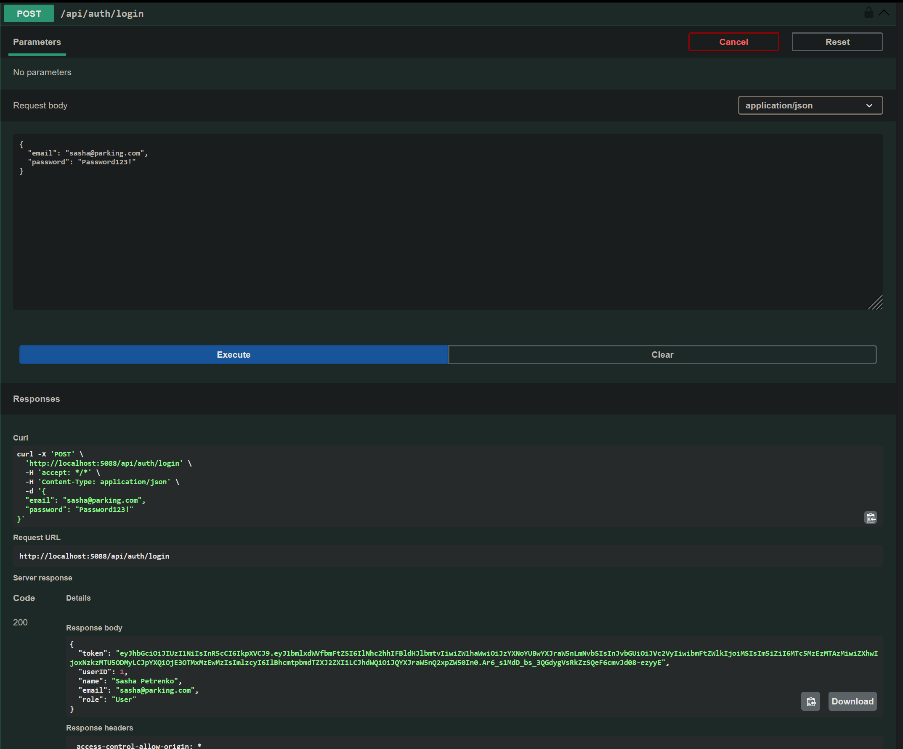

---

### 5. Клієнтський застосунок .NET MAUI

#### Каталог паркомісць користувача (Items View)
Тестування клієнта у середовищі Windows: відображення доступних місць, підсвічування статусів та виділення місць, заброньованих авторизованим користувачем Sasha Yaschenko ("Заброньовано вами"), з кнопкою скасування в 1 клік.
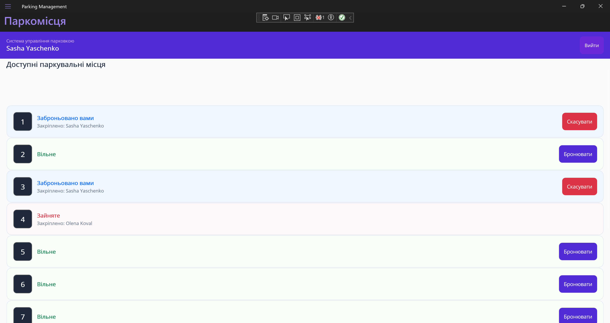

#### Екран підтвердження бронювання (Action View)
Інтерфейс оформлення бронювання обраного вільного паркомісця користувачем у додатку.
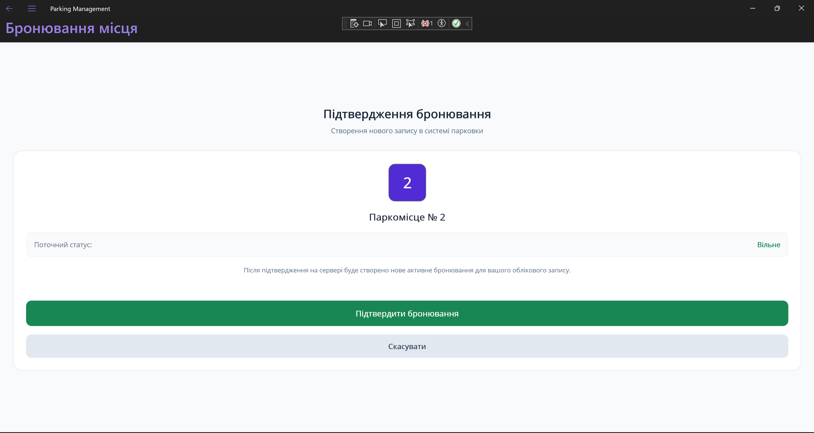
